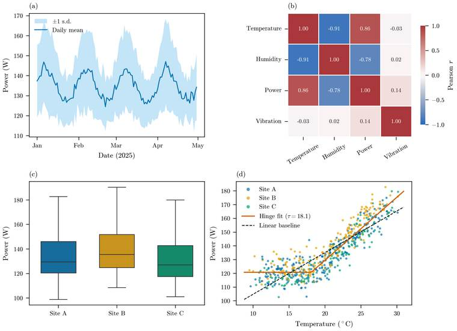

# Academic Typesetting Portfolio

This repository is a portfolio of academic typesetting examples. It contains a journal-paper layout, a thesis layout, TikZ/PGFPlots diagrams and a small Python figure pipeline. The PDFs are committed so they can be read directly on GitHub; the source files are included for inspection and rebuilding.

The examples show how I handle document structure, mathematical notation, references, tables, diagrams and figures in LaTeX. They are samples of formatting and production work, not published research.

> **Sample-data notice:** the research scenario and sensor readings are synthetic. A fixed-seed script generates all observations. They do not come from a real building, monitoring system, client project or experiment. The charts and fitted model are included to demonstrate the workflow; they should not be cited as empirical findings.

## Selected PDF samples

Each link opens the PDF committed under docs/samples/. Page counts refer to the current committed versions.

| Sample | Pages | What to look for |
|---|---:|---|
| [**Journal paper**](docs/samples/paper.pdf) | 3 | IEEE two-column layout, equations, cross-references, bibliography, summary table and four-panel figure. |
| [**Thesis layout**](docs/samples/thesis.pdf) | 16 | Title page, abstract, contents, list of figures, five chapters, two appendices, bibliography and index. |
| [**TikZ showcase**](docs/samples/tikz-showcase.pdf) | 2 | Transformer encoder, finite-state machine, PID block diagram and PGFPlots step-response curves. |

### Journal paper

The paper uses the IEEEtran class. Its example regression is a hinge model: the script searches candidate thresholds and solves the coefficients by least squares. The scatter panel shows that fit together with a dashed linear baseline. The generated numbers describe only the synthetic rows used to make the figure.

### Thesis layout

The thesis is organized as a multi-file book project. The title page and abstract are separate from the five chapters and appendices. It includes a bibliography, index, figure list, equations, tables and diagrams. The front page identifies it as a portfolio demonstration; it does not claim a university affiliation or degree.

### TikZ and PGFPlots

The standalone showcase contains vector diagrams written in TikZ. Shared node and arrow styles live in src/tikz/tikz-styles.tex. The same diagram source files are imported by the paper and thesis.

### Scientific figures

The Python pipeline creates four panels: daily mean power, a variable-correlation matrix, power distributions for three example sites, and power against temperature. The last panel shows both the fitted hinge curve and the linear baseline. The corresponding LaTeX table and numeric macros are generated by [scripts/generate_figures.py](scripts/generate_figures.py).

## What the examples demonstrate

The files in this repository provide examples of:

- **Paper and thesis layout:** page structure, section hierarchy, running headers, front matter, appendices, bibliography and index.
- **Mathematical typesetting:** aligned equations, matrices, operators, theorem environments and cross-references.
- **Bibliographies and tables:** BibTeX records, citation styles, booktabs rules and siunitx column formatting.
- **TikZ and PGFPlots:** diagrams and plotted curves that remain vector graphics in the PDF.
- **Python-generated figures:** data preparation, Matplotlib/Seaborn charts, summary statistics and LaTeX integration.

These examples show the source alongside the finished output. A client project may need a different class, institutional template, reference style, figure format or build process. The supplied manuscript and submission instructions determine those details.

For a description of the example work and the information needed to scope a project, see [Services and scope](docs/PREMIUM_BUNDLE.md).

## How the sample data are made

The data generator creates 2,880 hourly rows covering 120 days and assigns each row to one of three example sites. It calculates temperature, humidity, power and vibration values, then inserts 25 missing temperature values and 25 missing power values. scripts/generate_figures.py fills those gaps by interpolation before producing the figures and summary table.

The hinge threshold is selected by a grid search. For each candidate threshold, the script solves the intercept and slope by least squares and keeps the fit with the lowest residual sum of squares. The reported R-squared is calculated on those same generated observations. It is not a validation score for unseen data, and the example does not establish a causal relationship.

The PID block diagram and second-order step-response plot are separate control-theory illustrations. No controller is fitted to the sensor data or tested on a physical system.

## Build the documents locally

The project uses Python 3.10 or newer, TeX Live or MiKTeX with latexmk, and Poppler's pdftoppm utility for preview rendering.

From the repository root, install the Python dependencies and build all three PDFs:

    python -m pip install -r requirements.txt
    make clean
    make all

The main Makefile targets are:

| Command | Result |
|---|---|
| make data | Creates data/sensor_experiment.csv. |
| make figures | Creates the figure panels, combined chart, summary table and numeric macros under figures/. |
| make paper | Builds the IEEEtran paper. |
| make thesis | Builds the multi-file thesis. |
| make tikz | Builds the standalone TikZ showcase. |
| make previews | Renders the PDFs and figure overview to dist/previews/. |
| make before-after | Creates an unstyled/styled scatter comparison under dist/previews/before-after/. |
| make clean | Removes LaTeX auxiliary files and the contents of dist/. |

The build writes the current PDFs to dist/ and preview images to dist/previews/. The versions in docs/samples/ and docs/previews/ are the committed copies displayed in this README. After reviewing a successful build, update those copies with:

    make refresh-samples

Generated CSVs, figures, LaTeX auxiliary files and dist/ outputs are build products. Edit the source scripts and .tex files, then rebuild; do not edit generated files by hand.

## Continuous integration

GitHub Actions runs on pull requests, pushes to main, version tags, published releases and manual dispatches. The workflow:

1. Runs ruff check scripts.
2. Generates the synthetic dataset and figures.
3. Compiles the paper, thesis and TikZ showcase.
4. Checks the logs for undefined references and citations.
5. Collects PDFs and checksums, renders previews and uploads an artifact named pdfs.

The Actions artifact is retained for 30 days. Publishing a version tag also creates a GitHub Release containing the sample PDFs, checksums and preview JPGs.

See the [build workflow](.github/workflows/build-pdf.yml) for the exact commands and package list.

## Repository structure

| Path | Contents |
|---|---|
| [src/paper/](src/paper/README.md) | IEEEtran paper and bibliography. |
| [src/thesis/](src/thesis/README.md) | Thesis root file, preamble, front matter, chapters and appendices. |
| [src/tikz/](src/tikz/README.md) | Shared TikZ styles and diagram sources. |
| [scripts/](scripts/README.md) | Data generation, figure generation, PDF previews and before/after comparison. |
| [data/](data/README.md) | Notes about the generated CSV; the CSV itself is recreated by the script. |
| [docs/samples/](docs/samples/README.md) | Committed PDF samples. |
| [docs/previews/](docs/previews/README.md) | Committed JPGs used in this README. |
| [.github/workflows/](.github/workflows/README.md) | GitHub Actions build and release workflow. |

## Contributing and reporting issues

Corrections to the examples, build instructions and documentation are welcome. Read [CONTRIBUTING.md](CONTRIBUTING.md) before opening a pull request. Bug reports and feature requests can be submitted through the [Issues page](https://github.com/uzairjaved-prog/Academic-typesetting-portfolio/issues).

## Security

Please do not publish credentials, private manuscripts or sensitive client data in an issue. For a suspected security problem, follow the private reporting instructions in [SECURITY.md](SECURITY.md).

## License

The repository is released under the [MIT License](LICENSE). The synthetic-data notice above still applies: the sample values are generated for demonstration and are not real measurements.

## Contact

For enquiries about LaTeX paper formatting, thesis layout, mathematical typesetting, TikZ diagrams or research figures, use the [GitHub profile](https://github.com/uzairjaved-prog).
