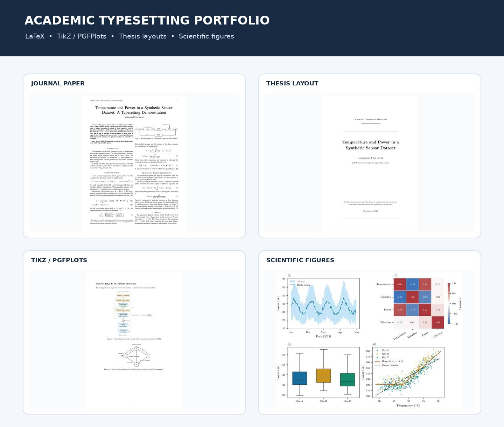
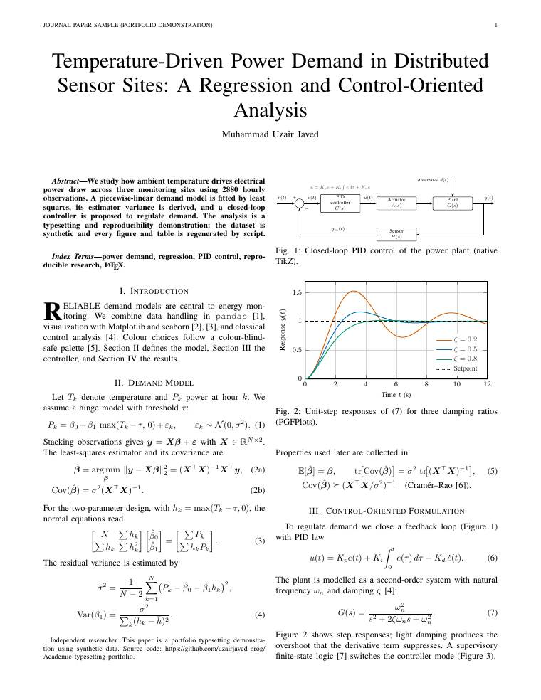
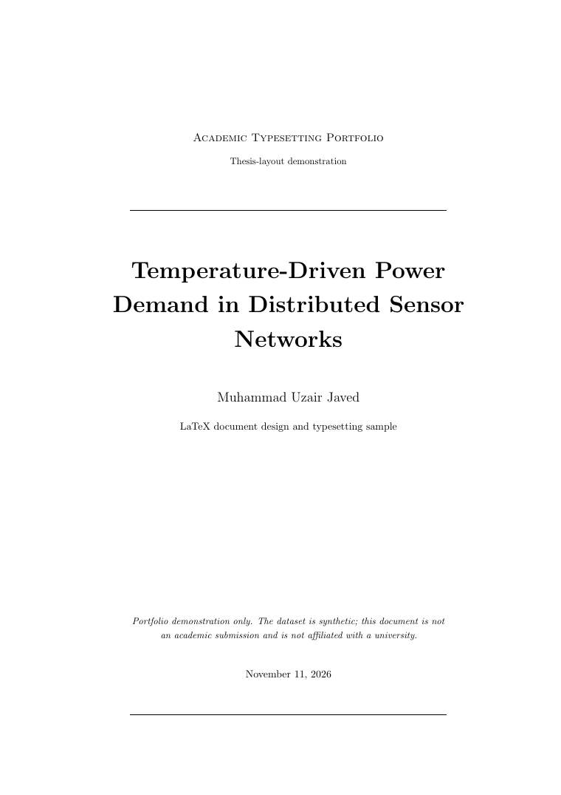
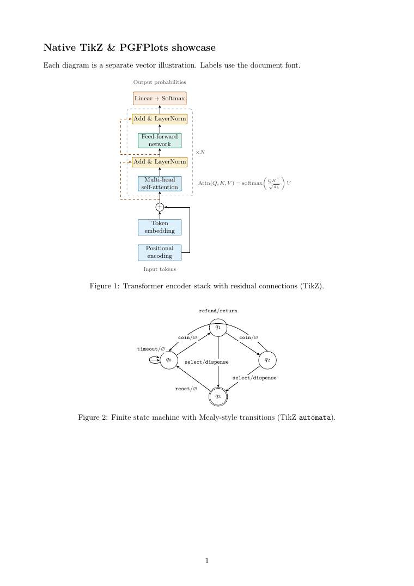

# Academic Typesetting Portfolio

**LaTeX papers and theses, TikZ diagrams, and scientific figures.**

This repository contains examples of academic typesetting work. The sources show how I format equations, references, tables, chapters, diagrams, and data figures, then build them into PDFs.

> **About the examples:** the sensor dataset and research scenario are synthetic. The values are generated by a fixed-seed script. They are included to demonstrate the document and figure workflow, not to report real measurements or academic research.

## PDF samples

The compiled PDFs are included in the repository. The current samples are 3 pages, 16 pages, and 2 pages, respectively. Open a PDF in GitHub to read it, or use the link to download the file.

| Sample | What it contains | PDF |
|---|---|---|
| **Journal paper** | 3 pages. IEEE two-column layout, equations, references, a summary table, and four data panels. | [paper.pdf](docs/samples/paper.pdf) |
| **Thesis layout** | 16 pages. Title page, abstract, contents, list of figures, five chapters, appendices, bibliography, and index. | [thesis.pdf](docs/samples/thesis.pdf) |
| **TikZ showcase** | 2 pages. Transformer, finite-state machine, PID block diagram, and PGFPlots step responses. | [tikz-showcase.pdf](docs/samples/tikz-showcase.pdf) |

### Journal paper

### Thesis

### TikZ and PGFPlots

### Scientific figures

The charts include a daily power series, a correlation matrix, per-site distributions, and a temperature-versus-power plot with both a hinge fit and a linear baseline.

[View the figure preview](docs/previews/scientific-figures.jpg) · [Figure-generation script](scripts/generate_figures.py)

## Services shown in these examples

- **LaTeX document formatting:** paper layouts, equations, references, tables, and consistent styles.
- **Thesis formatting:** title pages, front matter, chapter structure, page headers, appendices, and indexes.
- **Mathematical typesetting:** aligned equations, matrices, operators, and estimator derivations.
- **TikZ and PGFPlots:** vector diagrams, state machines, control blocks, and plotted responses.
- **Research figures:** Python data preparation, charts, summary tables, and LaTeX integration.

See [Services and scope](docs/PREMIUM_BUNDLE.md) for the types of work represented by the examples.

## Build locally

Use Python 3.10 or newer and TeX Live or MiKTeX with latexmk. The CI build also installs Poppler for PDF previews.

~~~bash
pip install -r requirements.txt
make clean
make all
~~~

make all creates the PDFs in dist/ and preview images in dist/previews/. The committed PDFs in docs/samples/ and JPGs in docs/previews/ are curated copies. After a successful build, refresh those copies with:

~~~bash
make refresh-samples
~~~

To create the before-and-after scatter comparison, run make before-after. It writes SVGs under dist/previews/before-after/.

## Repository structure

- [src/](src/README.md) — LaTeX source projects.
- [src/paper/](src/paper/README.md) — IEEEtran paper and bibliography.
- [src/thesis/](src/thesis/README.md) — multi-file thesis.
- [src/thesis/chapters/](src/thesis/chapters/README.md), [frontmatter/](src/thesis/frontmatter/README.md), and [backmatter/](src/thesis/backmatter/README.md) — thesis sections.
- [src/tikz/](src/tikz/README.md) — diagrams and PGFPlots source.
- [scripts/](scripts/README.md) — data, figure, and preview scripts.
- [data/](data/README.md) — notes about the generated dataset.
- [docs/](docs/README.md), [docs/samples/](docs/samples/README.md), and [docs/previews/](docs/previews/README.md) — committed portfolio files.
- [.github/](.github/README.md) and [.github/workflows/](.github/workflows/README.md) — repository templates and automated builds.

## Contact

For academic typesetting and LaTeX work, contact the repository owner through the [GitHub profile](https://github.com/uzairjaved-prog).

---

The sample research content is illustrative. For client work, the client's manuscript, data, citation style, and institutional requirements take precedence.
